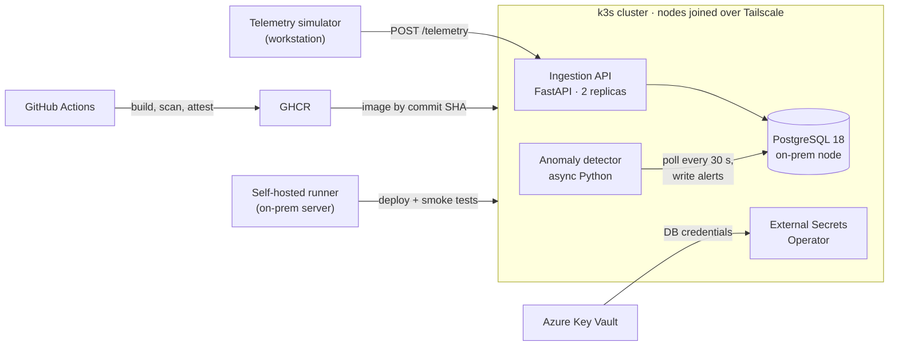
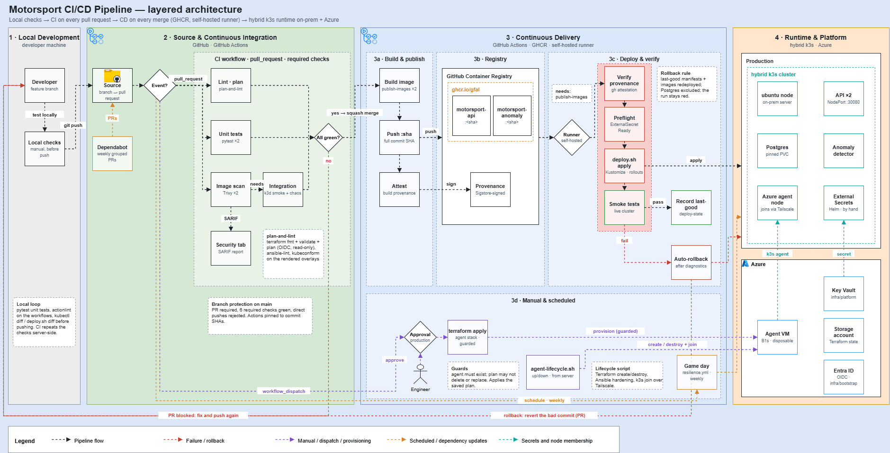

# Motorsport Telemetry Platform

[](https://github.com/gFal/motorsport-telemetry-platform/actions/workflows/pipeline.yml)
[](LICENSE)

A production-style platform that ingests live race-car sensor data, stores it in PostgreSQL and raises alerts when a car goes silent or a reading leaves its safe range. It runs on a hybrid **k3s** cluster (an on-premises Ubuntu server plus an on-demand Azure node), provisioned with **Terraform** and **Ansible** and delivered through a **GitHub Actions** pipeline with image scanning, signed provenance, automatic rollback and chaos testing.

## Highlights

- **Two services, one database.** A FastAPI ingestion API (2 replicas) and an async anomaly detector, both stateless apart from PostgreSQL 18.
- **Hybrid cluster.** k3s server on-premises; an Azure `Standard_B2ats_v2` agent created and destroyed on demand by Terraform, hardened by Ansible and joined over Tailscale.
- **Infrastructure as code.** Three Terraform stacks with remote state in Azure Blob Storage, and GitHub OIDC for CI, so there are no long-lived cloud credentials in the repository.
- **Secrets from Azure Key Vault**, synced into the cluster by External Secrets Operator.
- **Supply chain.** Images are scanned with Trivy, published to GHCR under the commit SHA, attested with build provenance, and verified before deployment.
- **Safe delivery.** Every merge is deployed and smoke-tested. A failed verification rolls back automatically to the last known-good commit.
- **Resilience testing.** Chaos tests (database outage, pod loss, bad credentials) run against an ephemeral k3d cluster on every pull request and against the live cluster weekly.
- **Hardened workloads.** Non-root containers, read-only root filesystems, `RuntimeDefault` seccomp, liveness and readiness probes designed around failure modes.

## Architecture



| Node | Role | Lifecycle |
|---|---|---|
| On-prem Ubuntu server | k3s server, PostgreSQL, External Secrets Operator, GitHub Actions runner | Always on while in use |
| Azure VM (`motorsport-agent`) | k3s agent for application pods | Created and destroyed on demand with `infra/scripts/agent-lifecycle.sh` |

The telemetry simulator runs on a separate workstation and posts readings to the API over HTTP. It produces a 20-lap race with fuel burn, tyre pressures and a physics-based brake temperature model, including a slow puncture and pit stop for car 1.

## Repository layout

```text
.
├── .github/
│   ├── workflows/
│   │   ├── pipeline.yml          # CI/CD: lint, test, scan, publish, deploy, rollback
│   │   └── resilience.yml        # Scheduled chaos tests against the live cluster
│   └── dependabot.yml
├── services/
│   ├── api/                      # FastAPI ingestion and query service
│   └── anomaly/                  # Anomaly detection daemon
├── k3s/
│   ├── base/                     # Kustomize base: deployments, services, DB schema and seed
│   ├── overlays/
│   │   ├── prod/                 # Live cluster: Key Vault SecretStore + ExternalSecret
│   │   └── ci/                   # Ephemeral k3d cluster used in pull requests
│   └── cluster-addons/           # Helm values for cluster add-ons (External Secrets Operator)
├── infra/
│   ├── terraform/
│   │   ├── bootstrap/            # CI identities (GitHub OIDC → Azure)
│   │   ├── platform/             # Key Vault and the External Secrets identity
│   │   └── agent/                # Azure agent VM and networking
│   ├── ansible/                  # Node hardening and Tailscale join
│   └── scripts/                  # State backend bootstrap, agent up/down
├── scripts/
│   └── deploy.sh                 # Deploy / rollback / known-good tracking
├── tests/
│   └── e2e/                      # Smoke and chaos suites against a running cluster
├── docs/
│   └── operations.md             # Runbooks
├── compose.yaml                  # Local development stack
└── .env.example
```

Unit tests live next to the code they test, in `services/*/tests/`.

## Tech stack

| Area | Tools |
|---|---|
| Application | Python 3.14, FastAPI, Pydantic, asyncpg, Uvicorn |
| Data | PostgreSQL 18 |
| Containers | Docker, Docker Compose, GitHub Container Registry |
| Orchestration | k3s, Kustomize, Helm, k3d (CI) |
| Infrastructure | Terraform (`azurerm` 5.x, `azuread`), Ansible, Tailscale, Microsoft Azure |
| Secrets | Azure Key Vault, External Secrets Operator |
| CI/CD | GitHub Actions (hosted and self-hosted runners), Dependabot |
| Quality and security | pytest, Trivy, kubeconform, ansible-lint, artifact attestations |

## Services

### Ingestion API — `services/api`

| Method | Path | Description |
|---|---|---|
| `GET` | `/health` | Liveness only. Never touches the database, so a database outage does not restart healthy pods. |
| `POST` | `/telemetry` | Store one sensor reading. `404` for an unknown sensor, `422` for an invalid payload (including NaN/Inf). |
| `GET` | `/cars/{car_id}/latest` | Latest reading for every channel on a car. |
| `GET` | `/telemetry/history?sensor_id=&minutes=` | Readings from the last 1–60 minutes. |

Interactive documentation is served at `/docs`. While PostgreSQL is unavailable, data endpoints answer `503` with `Retry-After` within seconds instead of hanging, and recover on their own.

### Anomaly detector — `services/anomaly`

Polls the latest reading of every sensor (default every 30 s) and writes alerts to the `alerts` table and a JSON-lines log.

| Alert | Condition (default, configurable by environment variable) |
|---|---|
| `SILENT` | No reading from a sensor for more than 60 s |
| `OUT_OF_RANGE` | Engine temperature above 120 °C, tyre pressure below 19 PSI, fuel load below 0 L |

Each alert fires once on the transition into the bad state, not on every poll. Because that state is held in memory, the deployment uses a single replica with the `Recreate` strategy.

## CI/CD

<p align="center">
  
</p>

| Trigger | What runs |
|---|---|
| Pull request to `main` | `terraform fmt`/`validate`/`plan` (read-only identity), `ansible-lint`, Kustomize render + `kubeconform`, unit tests per service, image build + Trivy gate on fixable HIGH/CRITICAL findings, then an **integration** job that deploys the PR's images to an ephemeral k3d cluster and runs the smoke and chaos suites |
| Push to `main` | Publish images to GHCR tagged with the commit SHA, with build-provenance attestation → on the self-hosted runner: verify provenance, deploy, run smoke tests, record the commit as known-good, or **roll back** to the last known-good commit on failure |
| Manual dispatch | `terraform apply` behind the `production` environment approval. Refuses to run if the agent VM is down or if the plan deletes or replaces anything |
| Weekly schedule + manual | `resilience.yml` runs the chaos suite against the live cluster and opens an issue on failure |

Deployments and chaos runs share a concurrency group, so they never overlap.

## Testing

| Layer | Location | Runs |
|---|---|---|
| Unit | `services/*/tests` | Every pull request |
| Smoke | `tests/e2e/smoke` | Pull requests (k3d) and after every deployment |
| Chaos | `tests/e2e/chaos` | Pull requests (k3d) and weekly on the live cluster |

Chaos scenarios cover a database outage, the loss of every API pod, a rollout with invalid database credentials, disk pressure (manual only) and a silent car (pending a remote-control hook in the simulator).

## Getting started

### Run locally with Docker Compose

Requires Docker with the Compose plugin.

```bash
git clone https://github.com/gFal/motorsport-telemetry-platform.git
cd motorsport-telemetry-platform
cp .env.example .env              # then set real passwords
docker compose up -d --build
```

The schema and seed data (two cars, ten sensors each) load automatically on the first start. Try it:

```bash
curl localhost:8000/health

curl -X POST localhost:8000/telemetry \
  -H 'Content-Type: application/json' \
  -d "{\"sensor_id\": 1, \"value\": 131.5, \"recorded_at\": \"$(date -u +%FT%TZ)\"}"

curl localhost:8000/cars/1/latest
```

Sensor 1 is car 1's engine temperature, so the reading above raises an `OUT_OF_RANGE` alert within one polling interval. Sensors that have never reported raise `SILENT` alerts, which is expected without the simulator running.

```bash
docker compose exec postgres psql -U pitwall -d motorsport \
  -c "SELECT alert_type, message, detected_at FROM alerts ORDER BY detected_at DESC LIMIT 5;"
```

### Run the unit tests

```bash
python -m venv .venv && source .venv/bin/activate
pip install -r services/api/requirements.txt -r services/anomaly/requirements.txt -r requirements-test.txt
(cd services/api && python -m pytest tests)
(cd services/anomaly && python -m pytest tests)
```

### Deploy to the cluster

Cluster deployment needs the Azure, Tailscale and GitHub setup described in [docs/operations.md](docs/operations.md), which also covers bringing the agent node up and down, applying Terraform and rolling back.

## Security

- No credentials in the repository. CI authenticates to Azure with OIDC; the cluster reads database credentials from Key Vault.
- Terraform state lives in a versioned, delete-locked storage account. Read-only identities run `plan` on pull requests; `apply` needs a manual approval.
- Images run as UID 10001 with a read-only root filesystem and are verified against their provenance attestation before deployment.
- Nodes are hardened by Ansible: key-only SSH, no root login, `ufw` default-deny, unattended upgrades.
- Third-party GitHub Actions are pinned to commit SHAs and kept current by Dependabot.

## Roadmap

- [x] Ingestion API, anomaly detection and PostgreSQL schema
- [x] Containerisation and Docker Compose
- [x] Hybrid k3s cluster with Terraform and Ansible
- [x] CI/CD with scanning, provenance, automatic rollback and chaos testing
- [ ] Observability: Grafana Alloy collecting logs (Loki) and Postgres metrics (Prometheus), kube-prometheus-stack, Grafana dashboards for race data
- [ ] Event streaming with Kafka

## License

[MIT](LICENSE) © Georgios Faltakas
